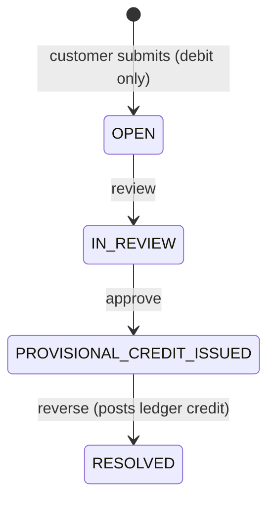

# Bitpro Transaction Dispute Portal

Spring Boot 3 / Java 21 API and Angular frontend for transaction disputes: submit, review, approve, reverse.

## Lifecycle



## Roles

| Role | Submit | Review | Approve | Reverse | Create accounts |
|------|:------:|:------:|:-------:|:-------:|:---------------:|
| CUSTOMER | yes | - | - | - | - |
| AGENT | yes | yes | - | yes | - |
| LEAD | yes | yes | yes | yes | - |
| ADMIN | yes | yes | yes | yes | yes |

The submitter of a dispute can never approve or reverse it. Roles cannot be changed through the profile API.

## Run locally

Requires Java 21, Maven 3.9+, Node 22+.

Backend (SQLite, demo users enabled, throw-away secret):

```powershell
$env:SPRING_PROFILES_ACTIVE = 'dev'
$env:JWT_SECRET = 'local-dev-secret-at-least-32-characters-long'
$env:APP_SECURITY_DEMO_USERS_ENABLED = 'true'
mvn spring-boot:run
```

Frontend (second terminal):

```powershell
cd frontend
npm install
npm start
```

Backend: http://localhost:8082 (Swagger UI at `/swagger-ui.html`). Frontend: http://localhost:4200.

Demo logins: `agent-user/agent-pass123`, `lead-user/lead-pass123`, `admin-user/admin-pass123`, `customer-user/customer-pass123`.

## Start and debug the API

### Start the API only

Use the backend command above. Check it: http://localhost:8082/actuator/health should return `{"status":"UP"}`.

Get a token and call the API:

```powershell
$login = Invoke-RestMethod -Method Post -Uri http://localhost:8082/api/v1/auth/login -ContentType 'application/json' -Body '{"username":"agent-user","password":"agent-pass123"}'
Invoke-RestMethod -Uri http://localhost:8082/api/v1/disputes -Headers @{ Authorization = "Bearer $($login.token)" }
```

### Debug in VS Code

Option A - run from the editor:

1. Set the three environment variables above in a `.vscode/launch.json` entry, for example:
   ```json
   {
     "type": "java",
     "name": "Transaction Dispute API",
     "request": "launch",
     "mainClass": "za.co.transactiondispute.TransactionDisputeApplication",
     "env": {
       "SPRING_PROFILES_ACTIVE": "dev",
       "JWT_SECRET": "local-dev-secret-at-least-32-characters-long",
       "APP_SECURITY_DEMO_USERS_ENABLED": "true"
     }
   }
   ```
2. Set breakpoints (for example in `DisputeServiceImpl`) and press F5.

Option B - attach to Maven:

1. Start with the debug agent on port 5005:
   ```powershell
   mvn spring-boot:run "-Dspring-boot.run.jvmArguments=-agentlib:jdwp=transport=dt_socket,server=y,suspend=n,address=*:5005"
   ```
2. In VS Code add an attach configuration (`"type": "java"`, `"request": "attach"`, `"hostName": "localhost"`, `"port": 5005`) and start it.

### Debug a single test

Open a test class (for example `DisputeWorkflowApiTest`), then use "Debug Test" above the method. Tests use an in-memory database and set their own JWT secret, so no setup is needed.

### Troubleshooting

- `JWT_SECRET ... must be configured`: set `JWT_SECRET` (32+ characters).
- Port 8082 busy: stop the other process or set `SERVER_PORT`.
- Login returns 401 for `lead-user`, `admin-user` or `customer-user`: set `APP_SECURITY_DEMO_USERS_ENABLED=true`.
- Stale local schema: delete `transaction-dispute.db` and restart.
- Docker Compose fails with "port is already allocated": the local dev backend is still using 8082. Stop it before `docker compose up`.

## Docker

The compose stack runs the API against PostgreSQL 16 (profile `postgres`) plus the frontend. It starts with demo defaults for the JWT secret and database password; override them for anything beyond local use.

```bash
docker compose up --build -d
# or with your own secrets:
JWT_SECRET="$(openssl rand -hex 32)" POSTGRES_PASSWORD="$(openssl rand -hex 16)" docker compose up --build -d
docker compose down -v   # stop and delete the database volume
```

Backend: http://localhost:8082. Frontend: http://localhost:8080. The compose stack and a local `mvn spring-boot:run` both use port 8082, so run one at a time.

To run the API against your own PostgreSQL instead of SQLite, set `SPRING_PROFILES_ACTIVE=postgres` and `APP_DB_URL` / `APP_DB_USERNAME` / `APP_DB_PASSWORD`.

## Database migrations

Liquibase runs on startup. `db/changelog/db.changelog-master.yaml` only lists includes; the changeSets live in numbered files under `db/changelog/changes/`. Each file sets `logicalFilePath: db/changelog/db.changelog-master.yaml` so changeSet identity matches databases created before the split. Do not remove that line or rename changeSet ids. Add new changeSets in a new numbered file and include it in the master.

The append-only audit triggers are database specific: changeSet 018 is SQLite only and 019 is PostgreSQL only.

SQLite stores timestamps as text (`yyyy-MM-dd HH:mm:ss`, set through the JDBC URL), so sub-second precision is lost there. PostgreSQL uses native `TIMESTAMP`.

## Concurrency

Reversal loads the dispute with `SELECT ... FOR UPDATE` (`DisputeRepository.findByIdForUpdate`), then re-checks status, idempotency key and ledger before posting the credit. Optimistic `@Version` columns and unique constraints are a second line of defence, and lock or version conflicts return 409. SQLite ignores `FOR UPDATE`, so the row-lock guarantee only holds on PostgreSQL; `ConcurrentReversalPostgresTest` exercises it there.

## Configuration

| Variable | Purpose |
|----------|---------|
| `JWT_SECRET` | Required, at least 32 characters. The app will not start without it. |
| `APP_SECURITY_DEMO_USERS_ENABLED` | `true` registers the admin, lead and customer demo users. Default `false`. |
| `APP_SECURITY_USERNAME` / `APP_SECURITY_PASSWORD` | Built-in agent account. |
| `APP_DB_PATH` | SQLite file location (default profile). |
| `SPRING_PROFILES_ACTIVE=postgres` | Use PostgreSQL. |
| `APP_DB_URL` / `APP_DB_USERNAME` / `APP_DB_PASSWORD` | PostgreSQL connection (postgres profile). |
| `POSTGRES_PASSWORD` | Database password for the compose stack (demo default if unset). |

## API

Base path `/api/v1`. Log in with `POST /auth/login` and send `Authorization: Bearer <token>`.

- `GET /accounts`, `POST /accounts` (admin)
- `GET /transactions`
- `GET /disputes`, `GET /disputes/{id}`, `GET /disputes/{id}/history`
- `POST /disputes` (needs `X-Idempotency-Key`)
- `POST /disputes/{id}/review`, `POST /disputes/{id}/approve`
- `POST /disputes/{id}/reverse` (needs `X-Idempotency-Key`)

Replaying the same key and payload returns the original result. The same key with a different payload returns 400. Reversing an already-resolved dispute returns 409.

## Test

```bash
mvn verify                                  # backend tests plus JaCoCo gate (80% line / 60% branch)
cd frontend && npm test -- --no-watch       # frontend unit tests (Vitest)
```

`ConcurrentReversalPostgresTest` starts PostgreSQL through Testcontainers and is skipped automatically when Docker is not available. `src/test/resources/docker-java.properties` pins the Docker API version so Testcontainers works with current Docker Desktop.

## Production notes

The stack is runnable on PostgreSQL, but it is still a demo-grade setup. For production: replace the local users with an OIDC identity provider, move secrets to a secret manager, use database-level pagination, and add an outbox for notifications.
